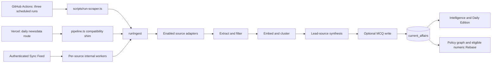
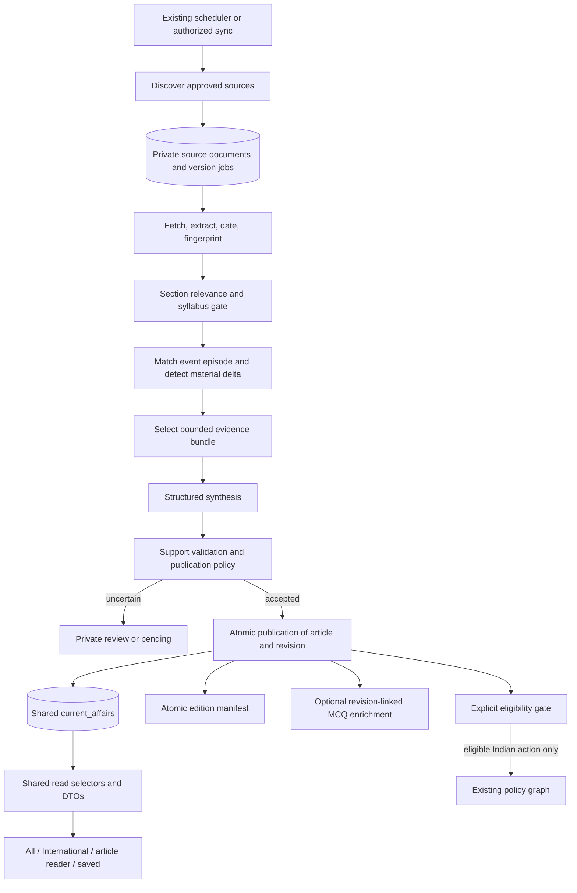

# Tark International News — Architecture and Integration Plan

**Planning document · 29 October 2026 · No implementation performed**  
**Repository:** `C:\Users\bentn\OneDrive\Desktop\SKU`  
**Audited checkout:** `85b3420`, including the working tree present during inspection.

**Reading guide:** [Current system and findings](#3-what-tark-actually-does-today) · [Target architecture](#6-target-processing-architecture) · [Data contracts](#8-data-model-and-compatibility-contracts) · [Interface integration](#11-read-api-routing-and-user-experience) · [Alternatives](#17-alternatives-and-why-they-were-rejected) · [Release gates](#18-validation-plan-and-release-gates) · [Delivery sequence](#19-delivery-sequence-and-reviewable-implementation-units)

## 1. Architectural decision

Build **International as a first-class section within Intelligence, powered by the same ingestion system and published article store**. Introduce a section-specific editorial policy and reliable document/development/version boundaries upstream. Reuse Tark's cards, article reader, bookmarks, syllabus connections, practice security, authentication, navigation shell, and branding downstream.

The product should answer four questions, in order:

1. What materially changed in the international public record?
2. What is established, what is attributed, and what remains uncertain?
3. Why is this relevant to the syllabus, and is there an evidenced India connection?
4. What is worth remembering or practising now?

It should produce a small, completable selection of meaningful developments, backed by a searchable archive. More world headlines are an input, not the product objective.

**Do not begin by enabling the two disabled world adapters.** Collection is only one dependency. Current freshness, source attribution, filtering, update detection, and graph assumptions would make that change misleading.

### Recommended launch boundary

- English output; reuse existing Hindi handling only where validated. No new multilingual promise.
- A small, rights-validated source portfolio, acquired through existing HTTP/RSS adapters.
- Three existing scheduled collection opportunities per day; no breaking-news SLA.
- A dedicated International page and finite daily selection, plus shared placements in All Intelligence.
- Shared article IDs and canonical article URLs across placements.
- Evidence-backed facts, explicitly attributed statements, and visibly separate analysis.
- International entries excluded from the current Indian policy graph and numeric Rebase until their domain contracts are extended and tested.
- Existing free-tier infrastructure as the initial operating target. Actual quotas and deployment plans must be measured, not inferred from historical documentation.

## 2. Evidence, scope, and assumptions

This is a static audit of source, migrations, workflows, tests, and product documentation, supplemented by official source and platform documentation. No credentials were inspected; no live database, ingestion job, migration, deployment, or application code was changed. Checked-in workflows establish intended schedules, not proof that production jobs run successfully.

`PRODUCT.md` establishes UPSC aspirants as the audience, Intelligence as the primary destination, source-linked substance as the priority, and no guarantees of complete factual verification. `docs/continuous-readiness-architecture.md` establishes the longer-term direction: minimize required consumption while tracking changes in the public record. Those principles guide this design. Historical implementation status in documentation is not treated as runtime evidence.

Defaults used because the brief leaves them open:

| Question | Planning default | Consequence if changed |
|---|---|---|
| General world news or exam intelligence? | Exam-relevant international intelligence | General journalism would require broader sourcing, editorial staffing, rights, and different ranking. |
| Budget? | Target no mandatory new infrastructure spend | Licensed reporting or paid retrieval can be added as explicit source profiles later. |
| Urgency? | Scheduled updates using existing cadence | Realtime coverage needs a separate latency and operating-cost decision. |
| Interface? | Extend the existing Intelligence shell | No parallel news application or visual redesign is required. |
| Historical corpus? | Prospective verified ingest, with optional bounded discovery | Legacy summaries never become new evidence through a metadata backfill. |
| Review capacity? | Limited review; uncertain items may remain unpublished | No claim of comprehensive international coverage or guaranteed daily count. |

The repository already had modifications to `src/components/DailyEdition.tsx` and `server-lib/seo/bot-renderer.ts`, plus untracked skill files. Future implementation must reconcile those changes and preserve them. This planning task adds only this document to the project.

## 3. What Tark actually does today

### 3.1 Executable ingestion topology



- `.github/workflows/scraper.yml:5` schedules 02:30, 10:30, and 16:30 UTC: **08:00, 16:00, and 22:00 IST**. `scripts/run-scraper.ts:21` calls the shared orchestrator with an eight-minute soft budget, 12 candidates per source, and 60 output stories.
- `vercel.json` also schedules `/api/cron/newsdata` at 00:00 UTC, **05:30 IST**. `server-lib/cron/pipeline.ts:27` passes a 25-second budget; the bundled Vercel function is configured for 30 seconds.
- `server-lib/sync-feed.ts:53` responds with 202 and dispatches per-source internal workers using `waitUntil`. A single-source run cannot construct cross-source clusters. The user cooldown is not a global ingestion lock.
- A separate PIB aggregator workflow writes dossiers; it is not the international collection spine. Radar has a separate daily workflow.
- The main orchestrator gathers sequentially, then clusters and synthesizes. A deadline between operations does not cancel a slow fetch or model call already running.

The old four-independent-pipelines description in `docs/ingestion-pipeline.md` is historical. Current wrappers substantially converge on `runIngest`; operational entry points and the PIB dossier pipeline still differ.

### 3.2 Reusable assets

| Asset | Reuse decision |
|---|---|
| Source adapter boundary and RSS/Atom parsing | Keep; extend metadata and result types. |
| HTTP/body extraction and source selectors | Keep; add bounded fetch policy, date provenance, and content-quality checks. |
| No-substantive-text rule | Keep. A headline is a discovery pointer, not enough evidence for a news brief. |
| Sentence spans and numeric token checks | Keep as partial evidence validation; do not represent them as semantic truth verification. |
| Existing LLM routing | Keep; apply shared stage budgets and cache by input/prompt version. |
| GS taxonomy | Reuse `GS2.IR.*` and cross-cutting GS1/GS3 nodes. |
| `current_affairs` and `summary.bullets` | Preserve as the public compatibility projection. |
| Existing cards, reader, bookmarks, exam insights | Extend optional metadata; avoid component forks. |
| Ingest run/decision ledger | Extend for actual coverage and omission accounting. |
| Server grading and answer reveal | Preserve; add scoped question selection and revision eligibility. |

### 3.3 Findings that change the design

| Finding and evidence | Architectural implication |
|---|---|
| `sources.ts:214,281` disables Wikipedia and UN News. Explicit IDs at `:315` bypass `enabled`. | International needs an enforced source policy across every entry point, not a UI toggle. |
| `classify.ts` rejects substrings including protest, death, arrest, clash, and killed before extraction. | A coup, humanitarian development, or international court action can disappear. Apply a scoped relevance policy. |
| `RawRef.pubDate` exists, but `Candidate` drops it. `cron/db.ts:56–57` resets creation/publication timestamps. | Preserve source, discovery, event, revision, and edition times separately. |
| Exact URL lookup precedes extraction; recently similar non-primary stories may be suppressed. | Stable-URL corrections and material updates need document versions and development identity. |
| `orchestrator.ts:525–529` synthesizes only the lead; `:631` credits all clustered source IDs. | Related coverage is not claim-level independent corroboration. |
| `verify.ts:156–174` checks cited spans and selected tokens; facts-empty context assertions can pass. | Negation, subject swaps, attribution, and legal status need stronger support checks/review. |
| Grounded failure falls back to ordinary structured synthesis at `orchestrator.ts:523–578`. MCQ generation lacks a grounded-only guard. | International publication must fail to pending/review rather than silently weaken evidence. |
| `orchestrator.ts:573` stores grounding as 100, while other contracts expect 0..1. Trust UI also grants recognized sources automatic 100%. | Introduce one trust resolver and a new versioned evidence contract; no automatic truth badge. |
| Gemini vectors default to 768 dimensions; per-item local fallback uses 512 dimensions. | Never compare mixed embedding spaces, even if dimensions happen to match. |
| Quiet or duplicate-only scans can count as source failures. | Separate transport health, extraction quality, editorial yield, and deferred work. |
| MCQ writes precede parent publication. | Generate after a committed article revision; invalidate dependent practice on correction. |
| Some cron guards compare absent configuration with absent input. | Touched internal dispatch routes must require configured, nonempty secrets and fail closed. |

These are scoped launch prerequisites where International touches shared behavior. This plan does not turn every existing issue into a prerequisite for an unrelated platform rewrite.

### 3.4 Product and storage constraints

- Signal Deck is the actual Intelligence default. Daily Edition fetches independently (`CurrentAffairs.tsx:321–338,1131–1138`). Rebase exists as backend/component work and direction; `RebaseEdition.tsx` is not currently mounted in the inspected frontend.
- The hub directly queries Supabase, retrieves 45 rows, then applies much of its filtering/search locally (`CurrentAffairs.tsx:685–730,880–945`). A client-only International tab could falsely report no results.
- `current_affairs` has a UUID and globally unique URL. Saved articles reference the UUID; current-affairs MCQs identify articles through `affair_url`. Preserve both identities.
- The checked-in core migration permits public reads with `USING(true)`. Drafts in that table would be visible to direct readers regardless of a frontend flag.
- `/intelligence/international` is currently liable to be interpreted as an article slug by App, CurrentAffairs, and SEO routing. Explicit section routing must precede article resolution.
- The policy authority registry and event jurisdiction are Indian (`union`/`state`). New rows default to graph processing pending, and some signals count all mapped articles.
- Numeric Rebase keys lack jurisdiction, dataset, methodology, forecast vintage, and currency. Expanding those keys casually would create false replacements.

## 4. Product contract: a section, not a publisher bucket

International membership is independent of where the publisher is based. An Indian ministry can publish an international development; a global publisher can report a purely domestic Indian measure.

Add a typed coverage dimension:

`coverage_scope = india | international | cross_border | unclassified`

- `india`: primarily domestic Indian action.
- `international`: foreign or multilateral development with supported syllabus relevance.
- `cross_border`: India-related bilateral, regional, or transnational development.
- `unclassified`: historical or unresolved classification. Absence of metadata is not evidence of geography.

International selects `international` and `cross_border`. All Intelligence can include every published scope. Keep existing topical categories orthogonal. Do not add foreign countries or institutions to the Indian ministry taxonomy.

### Editorial lanes

| Lane | Include when material | Exclude when routine |
|---|---|---|
| Diplomacy and neighbourhood | Agreements, substantive negotiations, policy shifts, official positions | Ceremonial visits and congratulatory statements |
| Institutions and international law | Membership, mandates, institutional reform, decisions, treaty stages | Generic speeches with no material development |
| Global economy and trade | Trade rules, sanctions, major reports/data revisions, financial-system changes | Intraday prices, company earnings, trading tips |
| Climate, biodiversity, and commons | Negotiated outcomes, scientific/public assessments, cross-border governance | Repeated summit previews without new substance |
| Security and humanitarian systems | Material regional/security changes, displacement governance, evidenced legal decisions | Tactical casualty tickers, graphic incident feeds, speculative escalation |
| Science, health, and geography | Major international cooperation or governance; testable geographical context | Every overseas discovery or localized incident |

An India link is helpful but not mandatory. A directly relevant global institution, treaty, ecosystem, or report can qualify without mentioning India. Never invent an India consequence to satisfy the template.

Use existing syllabus IDs: neighbourhood, bilateral, multilateral, UN reform, maritime, external sector, climate, and relevant geography/science/security nodes. Validate IDs against the actual taxonomy. Human-readable model tags alone are not canonical node identifiers.

## 5. Source strategy and admission

### 5.1 Source selection is a product dependency

Use a small portfolio with complementary roles. Do not assume an official website, RSS feed, or free-to-read page permits systematic product ingestion or reuse.

| Source family | Intended role | Launch position and verification status |
|---|---|---|
| MEA press releases, briefings, bilateral documents | India's positions and bilateral record | Priority adapter. Official RSS directory exists; runtime extraction and exact reuse policy still require admission testing. A browser fetch returned 403 during research, which does not prove the runner cannot access it. |
| WTO news and underlying decisions | Trade institutions and rule changes | Priority candidate. Official feed gateway identifies the feed and permits dissemination with attribution. Validate current endpoint, body extraction, and document-specific conditions. |
| Existing Indian Express/Hindu policy reporting | Context and independent reporting where accessible and permitted | Reuse appropriate existing adapters; do not presume international coverage or reuse rights from current domestic operation. |
| World Bank open data and specifically licensed publications | Development indicators and report updates | Admit individual products with their licences. Data terms do not automatically license all news pages. |
| IMF data products | Forecast/statistical developments with explicit dataset/vintage | Candidate under applicable data terms. Systematic downloading of ordinary content has different restrictions; no blanket IMF text scraper. |
| UN News and UN institutional records | Multilateral action and attributed institutional reporting | Conditional. Existing adapter is disabled. Resolve applicable permissions before systematic reuse; general UN terms are restrictive. |
| WHO and other thematic bodies | Health governance and primary decisions | Conditional. Verify each product/licence and commercial-context permission. Do not infer permission from educational use alone. |
| Reuters/AP or regional independent reporting | Independent international reporting and blind-spot reduction | Later, only through verified licensed/permitted access. No assumed free official RSS dependency. |
| Wikipedia Current Events | Discovery pointer only | Keep publication bypass disabled. Retrieve and qualify the actual underlying document independently; never attach a third-party URL to text actually sourced from Wikipedia. |

A useful initial public pilot can launch with the subset actually admitted, for example MEA plus WTO and a licensed/open-data product. **Breadth is declared, not fabricated.** If access leaves conflict/humanitarian lanes uncovered, label that gap rather than relying on unsupported summaries. Do not make the whole launch contingent on admitting every named source.

Official references checked for this plan:

- [MEA RSS directory](https://www.mea.gov.in/rss-feeds.htm) lists press releases, bilateral documents, and briefings; this establishes discovery categories, not a tested adapter.
- [WTO RSS gateway](https://www.wto.org/english/res_e/webcas_e/rss_e.htm) identifies `http://www.wto.org/library/rss/latest_news_e.xml` and requires attribution. Prefer HTTPS if validated; do not assume endpoint behavior from the directory alone.
- [World Bank data terms](https://data.worldbank.org/summary-terms-of-use) allow reuse under stated conditions and metadata exceptions; [general website terms](https://www.worldbank.org/ext/en/legal/terms-conditions) are separate.
- [IMF copyright and usage](https://www.imf.org/en/about/copyright-and-terms) distinguishes ordinary content/systematic downloading from statistical data usage.
- [UN terms](https://www.un.org/en/about-us/terms-of-use) and [WHO copyright](https://www.who.int/about/policies/publishing/copyright) establish material limits on reuse. These sources justify per-product admission, not a universal licence conclusion.

This is an engineering admission policy based on the published terms, not a legal determination of every possible use.

### 5.2 Extend source profiles

Preserve stable adapter IDs. Separate fields currently compressed into `tier`:

- editorial role: official record, participant statement, institutional news, independent reporting, commentary, discovery;
- topic competence and jurisdiction;
- publisher/ownership family and known syndication relationships;
- language and extraction strategy;
- approved hosts, redirects, discovery paths, and canonical URL rules;
- rights review URL/date, permitted acquisition/use, excerpt/body retention, attribution requirements;
- cadence, per-run cap, refresh policy, and operational enablement;
- policy version and rollout lane: shadow, review pilot, public.

Do not promote a government statement to universal factual authority. MEA is authoritative for what MEA said; an institution is authoritative for its own published decision or dataset. Claims about an adversary require attribution and appropriate evidence.

Use one enforced `canDiscover/canPublish` policy at every entry point. Explicit source IDs must not bypass disabled status, rights constraints, or rollout mode. Administrative overrides, if later added, must be authenticated, explicit, and audited.

### 5.3 Admission checklist

For each adapter, save representative fixtures and demonstrate discovery, substantive extraction, date provenance, canonicalization, unchanged fetches, corrections, error pages, and required attribution. Check robots/access guidance and exact terms; record the decision. Reject login/paywall circumvention as an acquisition strategy. Missing permission is a source-level hold, not an excuse to invent coverage.

Fetch only approved HTTP(S) destinations. Validate redirects and resolved destinations, reject private/local addresses, and bound response sizes, timeouts, content types, and redirects. This follows directly from consuming externally supplied feed links. Treat retrieved instructions as source text, never as authority over the worker.

## 6. Target processing architecture



The pipeline remains a modular monolith. Persist stage boundaries in Postgres and execute work on the existing GitHub runner. A durable queue is a state model, not a requirement to buy a workflow platform.

### Stage A — Discover and persist

Discover within per-source caps and save canonical references before model work. Preserve raw title, publisher date text, parsed date/precision, discovery time, original URL, canonical URL, and source policy version. Conditional fetches and healthy empty feeds are normal outcomes. Discovery success does not mean every discovered item was processed.

### Stage B — Acquire and version

Fetch under a source lease. Reject error/login pages and navigation-heavy bodies even when they exceed a character threshold. Normalize deterministically; hash with an extraction/normalization version. A changed extractor is distinguishable from changed publisher content.

A previously seen URL is eligible for conditional refresh while its event is active. Start with a configurable seven-day watch for active documents and slower refresh for deliberately tracked reports. No recursive global crawl. Persist a new document version only for meaningful content changes; retain observations separately from editorial changes.

### Stage C — Decide relevance before expensive synthesis

Replace unconditional world-tier acceptance and broad incident word bans with a scoped policy:

1. Cheap exclusions for plainly irrelevant content and access failures.
2. Canonical actor/institution/topic detection and candidate syllabus nodes.
3. Supported structural relevance: an institutional, legal, economic, scientific, geographic, or cross-border development.
4. Bounded model classification only for ambiguous cases, with reason codes.
5. An `unmapped_high_authority` review lane for material records that the taxonomy misses.

The existing semantic syllabus gate is available but is not currently invoked by the orchestrator. Wire and calibrate a real chosen gate; do not claim it already protects ingestion. Keep domestic thresholds unchanged unless a shared fix is separately validated.

### Stage D — Resolve the event and its change

Use embeddings to propose matches, then apply actor, object, jurisdiction, instrument/stage, and time constraints. Similar topic alone is insufficient. Country aliases, acronyms, and institution aliases come from a bounded registry; ambiguous Georgia/Congo names or WHO versus ordinary language require context.

Do not mix embedding namespaces. Cache vectors under provider/model/task/dimensions/version. If semantic generation fails, either defer or compute the entire comparison set in one local namespace with separately calibrated thresholds. Never splice local vectors into a semantic batch.

### Stage E — Build the evidence bundle and synthesize

Choose a small bundle, normally up to three substantive documents: the original institutional record, relevant independent reporting if admitted, and a substantive counterpart/technical document where needed. Deduplicate syndicated copies before counting source families.

The current first-6,000-character clamp can omit the operative clause of a long report. Select relevant paragraphs or sections deterministically, preserving original offsets, headings, and table labels. Each prompt span is document-qualified, for example `docA:v2:s7`; never reuse a bare `s7` across documents. At launch, prefer HTML and licensed structured data. Hold unsupported PDF/table extraction rather than summarizing the title; add that capability through separate fixtures.

Generate the brief in one bounded call with structured fields. Facts, attributed statements, and analysis are separate outputs. The source text cannot request tools, change the output schema, or override the worker's instructions.

### Stage F — Validate and commit

Validate schema, evidence references, dates, entity roles, quantities/units, negation, action/stage, and attribution. Unsupported or uncertain factual content goes to review/pending. International has no ordinary ungrounded publication fallback.

Commit the public article revision and publication state transactionally. Only committed current revisions can enter editions or practice. Optional enrichment must not delay the useful brief.

## 7. Three identities: document, event brief, and development

This distinction is the core of the design:

- **Document:** a publisher resource, which may change at the same URL.
- **Event brief:** a bounded episode presented as one Tark article with a stable UUID. For example, a particular treaty negotiation/outcome, not all relations between two countries forever.
- **Development:** a material step within that episode, recorded in an immutable article revision. Signature, ratification, and entry into force remain distinct developments even when presented in one updated brief.

One event brief can cite several documents. One document can inform more than one episode when its evidence permits it. Cluster membership is a retrieval aid; it does not define permanent identity.

### Update rules

| Observation | Stored result | Reader result |
|---|---|---|
| Same document/body | Update last checked; no synthesis | Nothing new |
| New outlet repeats the same facts | Attach coverage/provenance if useful | No duplicate card or new required reading |
| Existing episode advances to a new material stage | New development and article revision | One updated brief, visible change/timeline |
| Publisher corrects an earlier claim | New revision of that development; mark affected artifacts stale | Correction label and specific changed facts |
| Different period, country, treaty, or event | Separate episode or explicit comparison | No silent merge or replacement |
| Related topic but no same-event evidence | Separate candidate | Do not suppress as a semantic duplicate |
| Conflicting contemporaneous claims | Store attribution and uncertainty separately | No automatic verdict or numerical averaging |

The v1 preference is **one event brief with revisions**, rather than a fresh card for every stage. This reduces duplicated reading and preserves bookmarks. A broad dossier connecting many independent episodes can come later.

### URL compatibility edge case

Keep the original valid external `current_affairs.url` anchor, its paired `source`, and the existing article UUID on updates, even when another source becomes the stronger evidence. Never pair a new publisher name with the old publisher URL. New evidence URLs, publisher identity, and publication time live together in a separate current `evidence_lead` object in revision provenance and the DTO. A change of representative publisher must not generate a second article or break MCQ joins.

The current globally unique URL cannot represent two independent event briefs anchored only to the same rolling publisher page. Do not append fake fragments/query strings to evade it. In that uncommon v1 case, use another qualified event-specific document or hold the second episode for review. Removing URL uniqueness is a later migration requiring all MCQs to reference article IDs first. This boundary is preferable to silently corrupting article identity.

Canonicalization is conservative and source-specific: remove known tracking parameters, preserve semantic identifiers, and record redirects/aliases. Do not strip every query string; government document identifiers often live there.

## 8. Data model and compatibility contracts

### 8.1 Public article projection

Retain required existing fields and `summary.bullets`. Add indexed typed fields only for durable identity, visibility, selection, and time:

| Field | Purpose |
|---|---|
| `coverage_scope` | Explicit membership; legacy rows initially unclassified |
| `story_id` | Stable bounded event-episode ID, unique per published brief |
| `content_version` | Monotonic public revision number |
| `source_published_at` | Nullable publisher timestamp for the original anchor document, with precision in provenance; current evidence-lead time is separate |
| `first_seen_at` | First discovery; immutable |
| `updated_at` | Last material public change, separate from checks |
| `publication_state` | Published or withdrawn; preparation stays private |

Existing `created_at` stays immutable. For the new path, `published_at` means first publication by Tark and never changes on update; actual publisher time is `source_published_at`. Preserve legacy dates as legacy provenance rather than reinterpreting them as known source times. All stored instants are UTC. Derive edition dates explicitly in `Asia/Kolkata`.

Keep `ministry` compatible for existing readers, using a neutral category such as International Affairs when necessary; never place IMF, a foreign central bank, or a country into the Indian ministry registry. New UI reads institutions/actors from typed metadata. Explicitly exclude synthetic compatibility labels from all ministry facets, ministry SEO routes, and sitemap hub generation. Use an empty compatibility value instead only where existing consumers permit it. Do not infer section from this fallback string.

### 8.2 Private operational relations

These are logical schemas for implementation, not migration-ready SQL. Confirm deployed parity and naming first.

| Relation | Minimal responsibilities and constraints |
|---|---|
| `news_source_documents` | Stable source document ID; unique `(source_id, canonical_url)`; original URL/aliases, date provenance, first seen, last checked, conditional request metadata, current content hash. |
| `news_document_versions` | Unique `(document_id, content_hash, extractor_version)`; bounded normalized text/spans where permitted, language, retrieval time, rights snapshot, processing stage, attempts, retry time, lease owner/expiry, and a bounded persisted target-work manifest. Also serves as the durable work queue. |
| `news_stories` | Stable episode ID; actors, event object, jurisdiction, action family, event window, matching signature, coverage scope, review state, and a unique accepted match key. An atomic insert-or-read resolves races on a newly accepted identity; ambiguous matches require review rather than competing new stories. |
| `news_dispatch_revisions` | Immutable `(story_id, revision_no)`; development ID, change/correction kind, validated summary snapshot, source-version evidence, content/prompt/policy versions, publication time, superseded revision. Unique idempotency key. |
| `news_editions` | Unique `(IST_date, scope, edition_version)`; published manifest status, source/run coverage receipt, completion boundaries, generated time. |
| `news_edition_items` | Ordered article/revision membership; unique `(edition_id, position)` and `(edition_id, article_id)`; explicit section placements. |

Why six relations: documents and their versions solve mutable sources; stories and public revisions solve mutable knowledge; editions and membership solve finite completion. Work state lives on document-version rows, so there is no additional queue vendor or generic jobs framework. When a version informs multiple episodes, its persisted target manifest records each target key, story ID, stage, result, and retry status; the version completes only when all targets are terminal. Keep fan-out bounded and checkpoint each target atomically. If that becomes unwieldy, add a small per-target job relation rather than sacrificing correctness to a six-table target. Source policy remains code/config; `source_reputation` remains operational telemetry rather than editorial authority. Claim arrays may remain validated revision JSON initially; a separate general-purpose graph or claim warehouse is unnecessary for launch.

Full body retention is source-specific. A suggested operational default is seven days for permitted normalized input, followed by deletion of full text while retaining hashes, metadata, publication decisions, and permitted short evidence excerpts used in published revisions. A hash identifies the historical input; it cannot reconstruct a deleted body. Do not promise exact replay when rights/retention prevent it.

### 8.3 Versioned summary extensions

Keep legacy fields and types intact. Introduce shared runtime validation in one module used by worker, API, and client, replacing duplicated informal interfaces incrementally.

Illustrative new fields; placeholder IDs below are schema examples, not actual news:

```json
{
  "bullets": ["A concise, supported factual statement."],
  "tags": ["GS2 International Relations"],
  "sources": ["SOURCE_A"],
  "international": {
    "schema_version": 1,
    "country_codes": ["IN"],
    "regions": ["south_asia"],
    "institutions": ["institution:example"],
    "syllabus_node_ids": ["GS2.IR.BILATERAL"],
    "development_kind": "agreement_signed",
    "event_time": {"value": null, "precision": "unknown"},
    "india_connection": null,
    "analysis": []
  },
  "provenance_v2": {
    "schema_version": 1,
    "method": "source_support_v2",
    "article_revision": 1,
    "bullet_claim_ids": [["claim-example"]],
    "claims": [{
      "claim_id": "claim-example",
      "bullet_index": 0,
      "kind": "reported_fact",
      "support_status": "accepted",
      "evidence": [{
        "document_version_id": "opaque-version-id",
        "source_id": "SOURCE_A",
        "source_role": "official_record",
        "source_url": "https://example.org/document",
        "source_fingerprint": "sha256-placeholder",
        "span_id": "docA:v1:s2",
        "quote": "The exact supporting source excerpt."
      }]
    }]
  }
}
```

`summary.sources` remains a string array for old consumers; it denotes coverage, not independent verification. New provenance holds the document URLs and support links. New claim identity must not be an array-index fallback: `bullet_claim_ids` is a revision-bound mapping aligned with the validated bullet array, and each ID must resolve to a claim for that exact revision and bullet text. `bullet_index` is a convenience cross-check, never the proof association. If the association fails, omit the evidence anchor.

Do not reuse `live_cite_or_drop_v1` to imply the stronger new verifier ran. Introduce a method/version explicitly understood by the trust resolver. Omit ambiguous legacy grounding numbers on new records; use counts/status in `provenance_v2`. Unsupported schema versions fail to a plain brief with no trust assertions.

### 8.4 Atomic publication

A service-only publication function should:

1. Resolve or atomically create the story using its unique accepted match key; a losing insert reads the winning story. A story-row lock alone cannot prevent duplicate new-story creation.
2. Lock the resolved story row, then recheck lease ownership/expiry, expected revision/version, and the development idempotency key under the lock. A worker can expire while waiting. Return the committed result on a retried key.
3. Check accepted policy and required support against the locked revision state.
4. Insert an immutable revision and upsert the shared article projection without resetting identity/creation/publication dates.
5. Set graph eligibility/state explicitly in the same transaction.
6. Mark the source-version job published or attached and record the ingest decision.
7. Commit; enrichment is independently retryable afterward.

Use short transactions: no fetches or model calls while holding database locks. A stale worker must not overwrite a newer revision. Failed transactions leave no half-published brief. Any optional publication outbox can use the document-version stage state initially; introduce another table only if multiple independent durable consumers require it.

Practice is published separately after a parent revision exists. `has_quiz` becomes derived from an eligible linked MCQ or is patched atomically with that linkage; it is never proof that a preceding model call succeeded.

## 9. Evidence and editorial correctness

### 9.1 Distinguish five properties

| Property | Meaning |
|---|---|
| Source role | Who published this and in what capacity? |
| Evidence support | Does the cited document support the specific assertion? |
| Independence | Are sources distinct reporting/evidence families? |
| Uncertainty | Is the assertion disputed, preliminary, estimated, or attributed? |
| Editorial relevance | Why should an aspirant read it? |

None is a substitute for another. In particular, official does not mean independently confirmed, and three websites do not mean three independent sources.

### 9.2 Publication policy

- An institution's published decision can be supported by one authentic operative record; mandatory two-source rules would omit useful primary material.
- A participant's claim about another party remains explicitly attributed. The fact that the statement was made is distinct from the allegation being true.
- Material conflict/humanitarian allegations and disputed legal status require review unless the wording is narrowly attributable and the supporting record is unambiguous. Never automatically average competing figures.
- Every published factual assertion—including the headline, prelims pointer, and factual portions of analysis—must have evidence or a qualified attribution. No unsupported facts hidden outside the bullet validator.
- Analysis may explain plausible mechanisms but must identify itself as analysis and cite premises. An unevidenced India effect is absent, not filled with generic strategic language.
- A legal/institutional status is typed: proposed, negotiated, signed, ratified/acceded where applicable, effective, suspended, or withdrawn. A news report about a signature must not imply entry into force.

Retain numeric/acronym checks, then add subject/action/object, negation, attributed speaker, and temporal/status checks. The concrete gate first checks that each quote is an exact excerpt of the fingerprinted document version; next compares typed actor/action/object/status/date/quantity slots against source-structure rules or a reviewed fact record; then checks that the headline and derived study fields do not imply a stronger stage or broader scope. Normalize quantities with explicit currency, scale, period, and unit rather than digit containment. For automatic lanes, allow only claim families whose source extraction and slot checks have passed evaluation; ambiguous generated slots, narrative causality, or unmatched assertions require review. A model checking its own extracted slots is not an independent support test. Every public pilot brief receives release review against its selected evidence bundle. If review capacity is unavailable, those candidates remain private. For difficult prose, a second model may flag inconsistencies but cannot confer certainty. Review or omit unresolved assertions. Calibrate acceptance on labelled international examples; phrase the UI as “source-supported” or “evidence available,” not “truth verified.”

The existing contested numeric engine is too narrow for geopolitical dispute adjudication. Keep it as a review aid. Only compare values with the same country/entity, metric, unit/currency/scale, population, period, dataset/methodology, estimate type, and release vintage. A revised forecast is usually a temporal update, not a contradiction.

### 9.3 Shared trust resolver

Replace fragmented badge logic with one pure resolver for cards, editions, and PolicyBrief. Parse hostnames rather than substring-matching domains. Never grant 100% because a source name contains PIB/RBI/PRS or because it is newly allowlisted.

For v2, display exact support/attribution for current claim IDs and revision. For legacy records, preserve useful brief text while suppressing unsupported trust claims. A percentage, if ever retained, must explicitly describe a validated coverage measure, never source truth. Eliminate the current 0..1 versus 0..100 mismatch at both producer and consumer boundaries; do not guess the scale of historical values.

## 10. Ranking and finite selection

The current authority-heavy significance score should remain a domestic compatibility behavior initially. International uses a versioned policy whose starting rubric is a **hypothesis to calibrate**, not an exam-probability model:

| Dimension | Starting range | Evidence needed |
|---|---:|---|
| Syllabus fit | 0–30 | Valid node and specific testable connection |
| Materiality | 0–25 | Institutional/legal/economic/scientific consequence |
| Novelty of development | 0–20 | Difference from the previous accepted episode revision |
| India/cross-border consequence | 0–15 | Explicit record or clearly labelled supported mechanism; zero permitted |
| Evidence readiness | 0–10 | Quality/completeness of required support, not political alignment |

Hard eligibility gates run before scoring. A high score cannot compensate for missing evidence. Apply a modest configurable stale/repetition penalty; never penalize a material correction into invisibility. Do not give an automatic score boost for the number of websites carrying a wire copy.

Re-sort after final validated metadata is available; the current pipeline recomputes significance without necessarily reordering its processing queue. Selection happens across source lanes, not in source-registry order.

Initial edition policy:

- International selection: **up to four** current material briefs, with a target reading budget of about five minutes. Fewer is acceptable.
- Combined Daily Edition: preserve the existing cap of ten. Reserve up to seven places for eligible India-focused material and permit up to three International/cross-border placements. Unused International slots return to eligible domestic content, allowing ten useful domestic briefs when no International candidate qualifies. These are caps/reservations, not filler obligations; overlap uses one article ID.
- Regional/topic diversity is a soft tie-breaker after evidence and relevance. No mandatory continent quota.
- New article revision on an old episode can qualify as a development; new syndicated coverage alone cannot.

Persist selected article/revision membership in an edition manifest. Client, SEO, and practice read that manifest. An edition update creates a new manifest version, preserving the earlier receipt. Corrections/withdrawals invalidate unsafe revision rendering immediately and produce an annotated replacement manifest; immutability must not keep harmful stale facts on screen.

A completion message means “You have read the selected International briefs for this edition.” It never means all world events were checked. Display the actual item count, never hardcoded “All 10.”

## 11. Read API, routing, and user experience

### 11.1 One selection contract

Add a shared server selector and explicit safe DTOs, exposed through proposed endpoints:

| Endpoint | Responsibility |
|---|---|
| `GET /api/intelligence/feed` | Published feed, section/topic/country/institution/date/search filters, stable cursor, bounded page size |
| `GET /api/intelligence/articles/:id` | Current permitted article revision and safe evidence; resolve aliases without changing identity |
| `GET /api/intelligence/editions` | Published manifest for date/scope, actual count, revision-safe membership and receipt |
| `GET /api/intelligence/coverage` | Aggregate source-check freshness and honest coverage state; no raw rejected URLs or private review data |

Names are proposals; confirm collision-free routing during implementation. Register every handler in both `server.ts` and `api/server.ts`, since Vercel rewrites use the latter. Export shared route mounting to prevent future divergence.

Apply section, visibility, search, and facets **before pagination**. The new section and its placements use this selector immediately. Migrate existing hub readers and SEO to the same eligibility rules as part of integration; no application-wide data-layer rewrite is necessary.

Use keyset pagination with a deterministic tie-breaker. For the newest feed, a cursor includes filter hash, selected revision snapshot time, sort position, and article ID. Select the latest accepted revision at or before that snapshot from revision history, with current withdrawal/correction safety checks. Expire snapshots and request refresh when an invalidating correction affects them. Do not pretend `updated_at` on a mutable current row alone provides snapshot stability. Edition paging uses immutable membership directly.

Start with Postgres full-text search over published headlines and validated briefs, with institution/country aliases normalized for filters. No embedding search service is needed. Query-level facets must represent the eligible corpus, not whichever 45 items happened to load. Saved articles require a dedicated authorized saved query rather than filtering only the currently loaded feed.

Public reads may remain public where the existing product permits it; protected user actions use `fetchWithAuth`. Never require an unnecessary account solely because a new feed endpoint exists. Never expose service credentials or operational source inputs in DTOs.

### 11.2 Routing and SEO

- Reserve `/intelligence/international` before article-slug matching in App, CurrentAffairs, and SEO.
- Reuse the tracker/Intelligence shell and contextual nav rail. Add one International action; do not add another top-level app destination. Also provide an All / International switch in `DailyBriefHeader` at every viewport and navigation orientation: the contextual rail is desktop-only. Both entry points update the same route state. Parameterize the header masthead and domestic source list from the selected section and actual coverage receipt.
- Keep existing canonical article URLs, including ID resolution. Section placement is not a second article canonical.
- Encode filters in validated query parameters. Refresh, browser history, and closing an article restore its originating section/filter context.
- Add explicit section metadata, canonical, indexability, and published-only server rendering before the generic SEO wildcard.
- Client, bot renderer, sitemap, landing preview, and edition output must share publication eligibility. Withdrawn items disappear from all of them; invalidate caches as part of withdrawal.
- Do not generate country/institution names as ministry hubs. Add new section hubs deliberately, only when they have useful published content.

### 11.3 Reader experience

Keep Tark's current typography, navy/cream/gold/cyan system, disclosure pattern, and analytical tone. This is an information-model extension, not a cosmetic redesign.

On an International card, show the actual headline, source role, relevant geography/institution, and supported brief first. Expanded material can reveal:

1. **What changed** — the new material development, with prior-state context when available.
2. **What to remember** — article-specific testable distinctions, reusing exam-insight validation.
3. **Why it matters** — labelled analysis with supported premises.
4. **India connection** — only when evidenced or clearly qualified.
5. **Evidence and timeline** — exact source excerpts, attribution, source/publication/update times, and corrections.

Replace India-specific reader labels such as “federal dynamics” and “NCERT / Laxmikanth alignment” when they do not fit. Do not call every lead link “Primary source.” No map is required for v1; a later contextual locator must follow an explicit boundary/label policy.

Reuse `saved_articles.article_id`. Migrate `Profile.tsx` and saved selectors away from silently dropping null article joins: an authorized saved-item endpoint can return a minimal withdrawal tombstone without revealing withdrawn text. Read progress is distinct from saved state and from verified Rebase checkpoints. For new edition progress, namespace by user/device and edition manifest; track article ID plus revision so a material update can be presented as changed without resetting all reading. Completion stays qualified as local when stored only on the device.

Keyboard access, readable source popovers, visible focus, reduced motion, touch operation, and narrow-screen filters are acceptance requirements, not later polish.

### 11.4 State language

| State | Meaning and display |
|---|---|
| Loading | Fetch in progress; do not show “no developments” |
| Healthy with selection | Show selected brief count and actual source-check time |
| No qualifying developments | Successful source checks, no accepted material items |
| Filter zero | This filter returned no items; offer filter reset |
| Pending/review-limited | Relevant inputs exist but have not met publication policy |
| Partial/outage | Some admitted sources were not checked successfully |
| Stale | Show last successful check and last valid edition; no fresh coverage claim |
| Updated/corrected | Show changed development and affected revision clearly |
| Withdrawn | Stop rendering unsafe content; preserve an appropriate tombstone for saved/deep links |

A small coverage receipt can say which source families were checked, when, and whether the run was complete within its declared scope. It must distinguish no new content from unprocessed content. Private decision counts can support that receipt without exposing every rejected URL.

## 12. Practice and downstream boundaries

### 12.1 Scoped practice

The current article CTA passes context that App ignores before launching generic current-affairs practice. Correct that propagation before offering an International drill.

Use a typed launch context containing section, article IDs and/or edition ID, optional syllabus nodes, and requested mode. The server derives eligible MCQs from that context. Do not substitute unrelated PIB questions when the international pool is empty.

Add MCQ links to `article_id`, `article_revision_id`, source claim IDs, validation version, and status (`pending`, `eligible`, `stale`, `withdrawn`). Keep `affair_url` for compatibility until all consumers migrate. Generate only from accepted facts after parent publication. Validate the answer and explanation, including that distractors are demonstrably wrong rather than merely absent from the source. Uncertain questions remain out of the public pool.

On a material correction, mark dependent MCQs stale in the publication transaction. A later enrichment job can rebuild them. Existing completed attempts must preserve the exact historical question version for honest review; new attempts cannot receive stale questions. Existing URL-based MCQ upserts alone cannot satisfy this. Before enabling practice, migrate all consumers to article-ID linkage, replace the `affair_url` uniqueness contract with revision-aware uniqueness, and create a new immutable MCQ ID for each accepted question version. Retain `affair_url` as nonunique compatibility metadata only after those consumers are migrated. Verify that attempts snapshot the question/options/key/explanation or reference an immutable version; add such storage if absent. Do not rewrite old scores silently. Keep International practice off until this migration is complete.

The secure boundary remains the server: no `correct_index`, answer-revealing explanation, or answer key in pre-answer DTOs. Inspect grants as well as frontend selections: the current migration permits public explanation reads. International practice must wait until its answer-bearing fields are withheld through the underlying access paths, not merely omitted in one new endpoint. Reuse authenticated explanation/reveal and server-authoritative scoring.

Practice is optional for the initial news launch. No quiz is preferable to a plausible but unsupported quiz.

### 12.2 Policy graph firewall

Do not generalize the existing Indian authority registry by assigning foreign bodies invented constitutional/statutory statuses.

For new International records, set `graph_status = skipped` and an explicit graph eligibility field to false during publication. Both inline extraction **and background workers** must enforce this boundary; changing only the inline call leaves default-pending rows available to the worker.

A cross-border Indian executive action may later bridge deliberately if its Indian actor, instrument, jurisdiction, and supporting operative clauses pass the existing domain gate. An MEA statement about another government's action does not qualify just because MEA published it. Pure international developments use their article timeline.

Volume-sensitive Radar/Volcano/node-signal queries also need explicit scope selection. Excluding graph edges alone does not stop international article counts from inflating domestic exam signals. During pilot, keep existing domestic signals isolated; later evaluate distinct developments and section-specific series before combining them. Do not relabel article volume as exam probability.

### 12.3 Rebase firewall

Keep new International content outside numeric Rebase v1. This preserves its limited recognized-metric contract while the news section provides useful changes and evidence.

A future v2 identity should include, as applicable: entity/jurisdiction, metric, dataset and methodology, period, unit/currency/scale, estimate type, and release vintage. Issuing institutions and forecasts must not overwrite each other accidentally. Support A→B→A changes correctly; the current value-uniqueness behavior can treat a return to an earlier value as unchanged.

Before enabling it, resolve existing checkpoint/run-bounding concerns and choose either one combined mutation stream or separate scoped checkpoints. Filtering a world patch while advancing a single global checkpoint could skip unread India changes. No historical stored bullet, invented span, or metadata-only backfill may seed verified mutations.

## 13. Scheduling, leases, and failure recovery

### Execution policy

Keep GitHub Actions as the main executor. The Vercel cron and authorized Sync Feed should request bounded work through the same durable state. Heavy international processing must not depend on fitting inside a 25-second HTTP request. A 202 response means queued/requested, not successfully published.

Use workflow concurrency to reduce overlap, but database leases are authoritative across GitHub, Vercel, and interactive entry points. [GitHub concurrency documentation](https://docs.github.com/en/actions/how-tos/write-workflows/choose-when-workflows-run/control-workflow-concurrency) supports a shared group; it does not coordinate a separate HTTP worker. Scheduled Actions can be delayed, so publish actual freshness rather than an exact-time delivery guarantee; see [scheduled workflow behavior](https://docs.github.com/en/actions/reference/workflows-and-actions/events-that-trigger-workflows#schedule).

### Durable state machine

`discovered → fetched → classified → matched → synthesized → validated → published/attached`

Other terminal or resumable outcomes include `excluded`, `unsupported`, `review_required`, `retry_at`, `budget_deferred`, and `failed_permanent`. Persist reason codes and versions. A deferred candidate is not an editorial rejection.

- Claim available work atomically, using row locks/skip-locked or an equivalent short RPC; set owner and lease expiry.
- Heartbeat or extend only within a bounded job lifetime. Expired leases are reclaimable.
- Every state transition checks expected stage/version and owner. Retried external calls use cached successful results keyed to document/prompt/policy versions.
- Use bounded parallel fetches, initially two across sources and one per host, adjusted by measured responses and source policies.
- Fair scheduling reserves work for admitted International sources without consuming domestic output slots. Rotate source order and respect individual cadence.
- Do not hold a DB transaction during network/model work.
- Retry transient failures with jitter/backoff; honor rate-limit responses. Permanent access failures become source holds. Escalate poison jobs after a bounded attempt count.
- Persist all decision/coverage writes before finalizing the run; fire-and-forget writes must not disappear on process exit.

The runner should exit nonzero for an actual failed run and expose a structured degraded status for partial work. Zero accepted stories can be healthy; zero accepted stories caused by provider/auth failure is different. The current unconditional success exit after a returned result needs review when wiring the new runner mode.

### Separate health dimensions

Track successful transport/poll, discovery count, extraction quality, editorial acceptance, queue age, and publication independently. An unchanged source is healthy. A source that fetched successfully but only yielded irrelevant items is operationally healthy with low editorial yield. Budget exhaustion is a scheduling outcome, not source misconduct.

## 14. Work and cost budgets

Treat these as initial configurable safety limits to validate in shadow, not provider quota claims:

| International lane limit | Starting proposal |
|---|---:|
| Body acquisitions per scheduled run | Up to 20, chosen fairly from admitted sources |
| Brief synthesis attempts per run | Up to 4, including retries/fallback attempts |
| Ambiguous relevance model calls per run | Up to 2; included in total token cap |
| Bundle size | Normally up to 3 documents, with a bounded combined prompt |
| Combined international model tokens per run | Start with 30,000 input+output tokens across all stages |
| Newly published event briefs per day | Up to 8; updates share the same budgets |
| International daily selection | Up to 4 briefs |
| International MCQs during initial public launch | Off; later up to 2/day within an explicit enrichment budget |

Record actual usage by provider/model and stage. If a provider cannot report tokens, estimate conservatively and reconcile where possible. A source body/prompt cache and dedup-before-generation save more than choosing a cheaper model after duplicate requests have already happened.

Illustration only: 12 synthesis attempts/day at 2,500 input and 700 output tokens each would be 30,000 input and 8,400 output tokens/day, before other classification, retry, or enrichment work. The ledger must account for those too. Exhaustion leaves resumable pending work and an honest partial receipt; it never triggers automatic paid fallback or ungrounded publication.

Storage also needs measurement. At an illustrative 60 retained document versions/day × 10 KB × seven days, transient normalized bodies alone are about 4.2 MB before indexes/overhead. Eight 12 KB public revision records/day add about 35 MB/year before overhead. Existing question corpora and other project storage may dominate. Confirm actual database usage/headroom and prune allowed transient bodies; the historical “free storage is ample” assumption is insufficient.

Stop adding sources when acquisition grows without accepted-brief yield, evidence quality, or meaningful coverage improvement. Increase budget only after cost-per-accepted-development and domestic regression measurements justify it.

## 15. Security, visibility, and migrations

### Access boundary

All preparation, raw bodies, leases, rejected URLs, rights notes, and review decisions remain service-only. Enable RLS and revoke broad access on any operational tables placed in an exposed schema. A private schema is preferable where compatible with the chosen worker connection. Publication APIs return sanitized evidence excerpts and metadata only.

`current_affairs` remains the public projection. To support withdrawal, **replace** the current permissive SELECT policy with the intended published-only policy; adding another permissive policy does not restrict `USING(true)`. Test grants and policies through both anonymous and authenticated Data API calls. Server-role SEO bypasses RLS, so its query predicates must enforce the same visibility explicitly. Supabase's [RLS documentation](https://supabase.com/docs/guides/database/postgres/row-level-security) also documents service-role behavior and view considerations.

Avoid public views with owner-level bypass. If a view is used, apply appropriate invoker security and grants for the deployed Postgres version. Publication/lease RPCs should be service-only, preferably security invoker with explicit grants; do not use security definer simply to fix an access failure.

Touched cron/internal routes must reject absent or empty configured secrets, use credential headers rather than URL secrets, and enforce the same source policy. Protected mutations derive user identity from verified auth, not caller-supplied user IDs.

### Migration sequence

1. Introspect actual schema, policies, RPC grants, indexes, and deployed routes in an authorized implementation phase. Check `source_reputation`, graph state, MCQ grants, and `primary_operator` parity; repository placement does not prove a production object is missing.
2. Create additive private relations and nullable/default-safe public metadata. Do not classify legacy rows as international through publisher-name guesses.
3. Add scoped indexes and read functions. Validate DTOs and visibility with fixtures.
4. Replace public eligibility policies and update service-role readers. Prove old domestic published content remains readable.
5. Deploy shadow-capable workers/readers with International public publication disabled. Old bundles must not see pilot rows because pilot rows remain private.
6. Enable accepted public projections only after gates pass. Populate a bounded prospective corpus, not a bulk legacy evidence backfill.
7. Retain compatibility fields and additive schema during rollout; remove obsolete fields only after all consumers migrate.

Likely indexes: document source/canonical uniqueness; document-version identity; ready jobs on `(next_attempt_at, id)` restricted to resumable states; unique story/public brief linkage; revision `(story_id, revision_no)`; edition scope/date/version; published feed `(coverage_scope, updated_at DESC, id DESC)` where useful; and text-search GIN only for the implemented search predicate. Validate actual selector plans with `EXPLAIN (ANALYZE, BUFFERS)` on realistic staging data. Do not add JSONB/vector indexes speculatively or assume free tiers require pgvector.

## 16. Worked cases and failure behavior

These are synthetic architectural cases, not claims about current events.

### Case A — Bilateral agreement advances

An MEA release records signature. A counterpart release confirms the same action; three news sites repeat one wire report. One event brief is published, with separate official-record and reporting roles. Five URLs do not become five confirmations.

A later operative record establishes ratification. It matches the episode but has a different action/stage and effective time. Create a new development and article revision; update the existing brief and annotate the change. Do not imply entry into force until supported. The bookmark stays attached to the same article. A later independent negotiation about a different instrument becomes another episode, even if the countries and headline vocabulary overlap.

### Case B — Forecast changes without a contradiction

An institution publishes a growth forecast for a country and fiscal year, then revises it in a later release. Another institution uses a different vintage or methodology. Keep institution/dataset/vintage/period distinct. The later same-series release is an update, not proof the earlier report was fabricated; the other series is not automatically a contested claim. Initial International news can explain the revision while numeric Rebase remains disabled.

### Case C — A protest produces a material institutional response

Do not reject the candidate merely because its title contains “protest.” Determine whether the material development is a constitutional/institutional response, cross-border effect, or another qualifying syllabus-linked action. Exclude routine incident coverage, retain narrowly supported relevance, and preserve attribution on disputed allegations. If only sensational or thin text is available, hold publication.

### Case D — Correction at a stable URL

A conditional refresh finds a changed body and creates a document version. A material factual delta triggers a revision; cosmetic boilerplate changes do not. Preserve publisher time, first seen, article ID, and first Tark publication time. Mark linked practice stale immediately. If the source becomes inaccessible later, retained permitted excerpts support what Tark cited historically, while the interface shows retrieval age and avoids pretending the page was just rechecked successfully.

### Case E — Source or model outage

Transport failure schedules retry and records partial coverage. Existing valid published briefs remain available with accurate freshness. Successful unchanged polls remain healthy. A model outage leaves work pending; no headline-only substitute is published and no fabricated “nothing happened” message appears. Domestic jobs retain their allocated work budget.

## 17. Alternatives and why they were rejected

| Decision | Chosen approach | Why not the tempting alternative? | Revisit when |
|---|---|---|---|
| Product boundary | International inside Intelligence | A separate app repeats auth, bookmarks, routing, article UI, and study flows. | A genuinely different audience/product emerges. |
| Published storage | Shared `current_affairs` projection | A parallel world article table fragments identity and every consumer. | Existing table contracts become impossible to evolve safely. |
| Collection | Existing adapters with admitted source profiles | Merely enabling UN/Wikipedia does not fix evidence, updates, permissions, or relevance. | A new adapter passes admission. |
| Scope membership | Explicit geography/editorial metadata | Source nationality, ministry strings, and GS2-only rules misclassify content. | Taxonomy evidence warrants a new scope. |
| Work execution | Durable Postgres state plus existing runner | Process-only state repeats work after timeouts; a new orchestration vendor adds cost before measured need. | Queue age/throughput cannot meet declared cadence. |
| Source/event identity | Documents, event episodes, and immutable revisions | Exact URLs miss corrections; embedding similarity alone merges distinct stages/events. | More complex dossiers need a separate topic graph. |
| Event presentation | One bounded brief with material revisions | A card for every outlet/stage creates repeated reading and fragmented bookmarks. | Reader research shows particular recurring events need separate episode splits. |
| Evidence | Claim-qualified bundles and explicit attribution | An official-source allowlist or second LLM cannot certify truth. | A stronger evaluated verifier becomes available. |
| Source counts | Coverage and independence recorded separately | Syndication multiplies websites without multiplying evidence. | Ownership/syndication information improves. |
| Ranking | Materiality/novelty/syllabus rubric | Recency-only produces a firehose; authority-only privileges ceremonial official releases. | Labelled evaluation supports different weights. |
| Search/dedup infrastructure | Postgres search and bounded in-memory matching | A global vector database is unnecessary at this scale and does not solve semantics. | Corpus size/query latency justifies it empirically. |
| Policy graph | Explicit domestic bridge only | Foreign institutions do not fit Indian legal authority and ripple rings. | A tested international event/authority model is designed. |
| Rebase | Disabled for new International data initially | Country/dataset/vintage collisions would create false knowledge replacements. | V2 identity, ordering, and checkpoint gates pass. |
| Practice | Optional, after version-safe publication | Immediate model-generated questions can leak answers or teach superseded facts. | Evidence and immutable question linkage pass tests. |
| Editions | Shared persisted selection manifests | Independent browser/bot queries give different editions and unstable completion. | Product deliberately abandons finite completion. |
| Breadth | Declared small portfolio | Global headlines without rights, evidence, or review create misleading coverage claims. | New source lanes demonstrate useful yield. |

## 18. Validation plan and release gates

### 18.1 Build an evaluation corpus before tuning

Create a rights-permitted fixture corpus with at least 120 labelled candidates: roughly 60 relevant international/cross-border developments, 30 irrelevant or ceremonial items, and 30 adversarial/edge examples. Include more than one source family and regional context. Split tuning and held-out cases by event episode, not by URL, to avoid syndicated leakage. Document labels and reviewer disagreements.

Add a pair set of at least 60 examples covering same-event duplicates, material updates, corrections, and deceptively similar distinct events. Tune local and semantic matching separately. These are practical starting sample sizes, not proof of universal accuracy.

A seven-to-fourteen-day shadow period is a recommended minimum observation window, not a substitute for enough representative cases. Low-volume sources may need longer.

### 18.2 High-value automated and review checks

| Area | Required cases and expected outcome |
|---|---|
| Existing identity | All and International return the same article UUID/canonical URL; bookmarks survive revision and section switching. |
| Section query | A relevant item beyond the old first 45 global rows is discoverable on the first scoped query. Filters/search/facets apply before pagination. |
| Time | Source time, first discovery, Tark publication, event date, and update remain distinct; 23:59/00:00 IST, date-only inputs, and unknown zones do not create false precision. |
| Stable URL | Unchanged content causes no generation; material correction creates exactly one version; first publication/creation timestamps do not reset. |
| Event matching | Signature and ratification are distinct developments; similar treaties/countries remain separate; same-name countries/places do not merge. |
| Embeddings | Failure on one item never mixes model spaces; local fallback uses local thresholds/comparisons throughout. |
| Evidence | Wrong country, swapped subject, negation, unsupported cause, altered unit, invalid span, and uncited headline are rejected or reviewed. |
| Independence | Three syndicated copies remain one evidence family; source coverage badges make no unsupported verification claim. |
| Publication race | Two workers creating the same accepted episode yield one public brief; stale lease/revision cannot overwrite a newer result; retry returns the committed result. |
| Fan-out retry | A document supporting several target episodes records each target's progress; one failed target cannot duplicate another or falsely complete the version. |
| Failure recovery | Crash after every stage resumes; no leaked draft, duplicate model result, orphan quiz, or partial publication. |
| Source health | Valid empty/unchanged scans remain healthy; HTTP failure, low extraction yield, irrelevant output, and budget deferral remain distinct. |
| Visibility | Anonymous/authenticated users cannot read drafts, full input bodies, leases, rights notes, or review queues. Published-only predicates hold for API, direct Data API, SEO, preview, and caches. |
| Route parity | Section does not resolve as an article; refresh/back/forward/close preserve scope; both Express entry points mount the same endpoints. |
| Withdrawals | Unsafe brief removed from feed, SEO, edition rendering, and new practice; saved/deep links show an authorized tombstone without exposing withdrawn content. |
| Practice | Correct scoped pool; no answer/answer-revealing explanation before reveal; stale revision excluded; historic attempts retain their original question. |
| Graph/analytics | International rows never enter Indian graph workers or inflate domestic article-volume signals; deliberate domestic bridges pass actor/instrument gates. |
| Rebase | New International briefs produce no v1 ledger writes; legacy summaries never gain fabricated provenance. |
| Edition consistency | Client/bot/practice share manifest IDs and counts; overlapping placements do not create duplicate items; unused International slots can return to domestic content. |
| Accessibility | Narrow-screen section/filter use, keyboard source inspection, reduced motion, and focus recovery work. |

Run focused existing suites for article exam insights, syllabus mapping, serverless routes, rebase boundaries, and Radar where touched, plus relevant TypeScript checks and build. Run broader repository checks when implementation crosses their contracts. This planning task itself does not require an application build or live ingestion.

### 18.3 Proposed public launch thresholds

These are explicit initial gates to approve/tune during implementation:

- No known privacy leak, false trust badge, unsupported legal stage, wrong-identity merge, answer leak, or duplicate-publication race in the required critical cases.
- Every public pilot claim has resolvable evidence or honest attribution; a human review sample finds no unsupported material factual assertion. Sampling is a gate, not a guarantee about all future output.
- At least 90% precision for relevant/not-relevant acceptance on the held-out set, with false negatives reviewed by lane; no automatic publication when support is uncertain.
- No false merge on the critical stage/jurisdiction pair set. Measure duplicate/update precision and report actual sample size; avoid impressive percentages on tiny samples.
- Healthy admitted sources produce successful discovery/extraction fixtures, including empty and changed cases.
- Queue age, model/fetch usage, and reviewer workload fit the chosen budgets. A starting internal target is discovery-to-committed-brief p95 under 20 minutes for accepted ready work; publication-to-discovery lag is reported separately according to poll cadence.
- Domestic ingestion, shared article access, bookmarks, and existing edition capacity show no material regression against a fixed baseline replay. Live output counts alone cannot isolate a regression from the news cycle.
- Database security/performance review and selector query plans pass on staging. No production parity assumption is left unresolved for touched objects.

Hold the affected lane if a gate fails. The news section may launch without practice, broad regional coverage, Rebase, or an international graph.

## 19. Delivery sequence and reviewable implementation units

The order is a dependency sequence, not a promise of calendar dates. Indicative effort is about **15–25 focused engineering days**, plus source-permission lead time and shadow observation, assuming one engineer familiar with this stack and available editorial review. Actual estimates follow schema parity and source admission; permission delays cannot be solved with code.

| Phase | Work and concrete output | Exit gate |
|---|---|---|
| 0 — Establish baseline | Inventory actual schema/grants/routes/provider quotas; capture domestic fixtures; choose source subset; record rights and extraction admission decisions. | No unknown touched production contract; sources have explicit status; private evaluation fixtures ready. |
| 1 — Shared correctness boundaries | Source-date threading, immutable timestamps, trust resolver, source enablement enforcement, fail-closed internal invocation, compatible embedding batches, accurate health states. | Focused regression cases pass; existing domestic behavior preserved except intentional documented correctness fixes. |
| 2 — Durable private pipeline | Documents/version jobs, story identity, revisions, leases, work manifests, scoped relevance, evidence bundle, strict publication policy. Run shadow only. | Restart/race/fan-out tests pass; no public pilot data; labelled evaluation meets gates. |
| 3 — Integrated reading | Published projection, scoped selector/API, explicit route/nav, shared cards/reader metadata, saved/tombstones, edition manifests, SEO/preview parity. | End-to-end route/visibility/edition tests pass; domestic capacity preserved. |
| 4 — Reviewed public pilot | Enable a small admitted source subset, initially with human release review. Keep graph/Rebase firewalls and practice off. Measure quality, omission reasons, cost, and actual coverage. | Sustained gates, manageable review queue, accurate coverage states, rollback drill passed. |
| 5 — Optional practice | Article-ID migration, immutable MCQ versions/snapshots, scoped launch context, validation, answer-field access hardening, correction invalidation. | Quiz integrity and historical-attempt tests pass before CTA is enabled. |
| 6 — Earned expansion | Add sources/languages/structured reports by lane; later design international Rebase or dossier graph only if needed. | Each addition improves measured coverage/quality within budget; no inherited automatic eligibility. |

Each phase should be delivered as a small set of reviewable changes. Separate schema/visibility foundations, worker behavior, read integration, and optional practice so rollback and evidence remain clear. A feature flag is useful for UI/publication rollout, but is never the only boundary protecting private candidates.

### First implementation package

The first execution assignment should contain Phase 0 and a narrow Phase 1, not “build International.” Its reviewable output is: parity findings, fixed fixtures, admitted source profiles, date/provenance contracts, trust resolver behavior, and explicit route/source policy tests. That proves the foundation before new public news is generated.

## 20. File and dependency map

Proposed new modules are marked **new**; their names are suggestions, not files created by this plan.

| Existing location / proposed module | Intended responsibility |
|---|---|
| `server-lib/cron/ingest/types.ts`, `sources.ts` | Extend source/reference metadata; enforce source profiles; preserve publisher dates. |
| `server-lib/cron/ingest/extract.ts` | Typed fetch outcomes, conditional refresh, bounded host policy, extraction fingerprints and spans. |
| `server-lib/cron/ingest/classify.ts`, `syllabus/*` | Scoped relevance; canonical syllabus IDs and calibrated matching. |
| `server-lib/cron/ingest/embeddings.ts`, `cluster.ts` | Namespace-safe vectors, match candidates, independence-aware coverage. |
| `server-lib/cron/ingest/orchestrator.ts` | Delegate resumable stages; preserve existing domestic wrapper compatibility. |
| **new** `server-lib/news/source-policy.ts`, `identity.ts`, `worker.ts` | Admission rules, episode/development identity, leases, work manifests, stage budgets. |
| **new** `server-lib/news/publication.ts`, `evidence.ts` | Versioned support policy, atomic publication, corrections/withdrawals and invalidation. |
| `server-lib/cron/ingest/synthesize.ts`, `verify.ts`, `contested.ts` | Document-qualified bundles; partial verification reused honestly; unsupported conclusions held. |
| `server-lib/cron/db.ts` | Stop timestamp resets in touched paths; preserve URL/UUID identity; route new publication through transaction boundary. |
| **new** `src/lib/news-contract.ts` or an equivalent genuinely shared module | Runtime DTO/schema validation usable by server and client without browser/server import leakage. |
| **new** `server-lib/news/read.ts`, `routes.ts`, `editions.ts` | Shared feed/article/edition eligibility, search/facets, snapshot cursors, manifests and coverage receipts. |
| `server.ts`, `api/server.ts` | Shared route mounting and auth/secret parity. |
| `src/App.tsx`, **new/shared** route parser, `src/lib/seo.ts` | Explicit section routing, context restoration, canonical article identity. |
| `src/components/CurrentAffairs.tsx`, `VerticalNavRail.tsx`, `DailyBriefHeader.tsx` | International navigation at all viewports/orientations, section-aware masthead/source receipt, query-backed scope/facets, states and saved view integration. |
| `src/components/NewsSignalCard.tsx`, `PolicyBrief.tsx`, `TrustUI.tsx` | Shared provenance resolver, appropriate labels, exact claim/revision evidence links. |
| `src/components/DailyEdition.tsx` | Manifest-based selection and actual-count completion; reconcile current working-tree edits. |
| `src/components/Profile.tsx`, `landing/IntelligencePreview.tsx` | Saved tombstones, published eligibility, representative public preview. |
| `server-lib/seo/routes.ts`, `bot-renderer.ts`, `sitemap.ts` | Section hub before wildcard, manifest parity, withdrawal/cache handling; preserve current edits. |
| `server-lib/questions.ts`, `explanation.ts`, `submit-quiz.ts`, MCQ worker/DB helpers | Optional scoped immutable practice and authoritative reveal/grading. |
| `server-lib/policy/events.ts`, graph workers and node/Volcano queries | Explicit domain eligibility and domestic metric isolation. |
| `server-lib/cron/ingest/rebase.ts`, `server-lib/rebase.ts` | Enforce International v1 exclusion; future v2 is a separate design/release. |
| `scripts/run-scraper.ts`, `.github/workflows/scraper.yml`, sync/cron wrappers | Durable executor, accurate run outcomes, workflow concurrency and shared leases. |
| `supabase/migrations/` | Additive state/identity/visibility/index migrations after schema parity; optional MCQ evolution later. |
| `scripts/tests/`, existing source-local tests | Focused fixture, concurrency, security, route, selector, correction, and integration tests. |
| `map/` and active docs | Update change-impact/system documentation during implementation under its own `AGENTS.md`; do not propagate historical status as current fact. |

## 21. Operations, rollback, and expansion decisions

### Observability

Persist run ID, policy/model/prompt versions, requested/admitted sources, poll outcomes, candidates by decision reason, oldest pending age, accepted revisions, independent source families, model/fetch usage, and stage timing. Public receipts expose only safe aggregates and freshness.

Track material-claim review outcomes, wrong merges/splits, duplicate suppression mistakes, update detection, correction latency, per-lane source-family concentration, and cost per accepted development. Measure useful reading/practice behavior without converting this launch into a new personal analytics system. Reviewer override reasons feed the evaluation corpus.

A coverage-gap report should distinguish unavailable source, not configured source, rejected relevance, missing evidence, review hold, and budget omission. This is the useful innovation behind a finite International section: it can account for its declared limits instead of treating an empty page as proof nothing happened.

### Rollback drill

1. Stop International discovery/publication; leave domestic work operational.
2. Disable the section entry and scoped practice CTA if the interface is at fault.
3. If published content is unsafe, withdraw the exact affected article/revision set through the public eligibility boundary, invalidate editions/search/SEO caches, and mark dependent questions stale. Hiding navigation alone is insufficient.
4. Keep article IDs, source history, decisions, and additive schema for recovery. Saved links show appropriate tombstones; do not delete rows and cascade-delete bookmarks.
5. Restore only after corrected fixtures and replay prove the failure is contained. Resume pending jobs through idempotent transitions, not a blind full reingest.

### Conditions for later investment

- Add a source when it closes a documented coverage gap with admitted access and useful yield.
- Add structured PDF/table extraction when important licensed records are repeatedly held for that reason.
- Add languages when original-language evidence and translated claims can be evaluated adequately.
- Add a dedicated worker service when queue age/runtime constraints persist after fair scheduling and stage isolation.
- Add a richer international graph when actual reader workflows require relationships beyond episode timelines, with a new jurisdiction/authority model.
- Enable International Rebase only after identity, temporal ordering, and scoped checkpoint semantics are independently correct.

## 22. Definition of done

International is architecturally integrated when a qualified international document can be discovered, versioned, matched to an event episode, distilled with exact support, published under an existing-compatible article identity, found through scoped search, read/saved/shared in the existing shell, selected consistently into an honest finite edition, corrected without losing history, and withdrawn across all readers when necessary.

That must happen without leaking drafts, inventing verification, duplicating source coverage, starving domestic ingestion, misclassifying foreign institutions into India's policy graph, or silently generating unrelated/stale practice.

The first successful release is a small, transparent, dependable International section. Wider coverage is earned through evidence and measured operating capacity.
