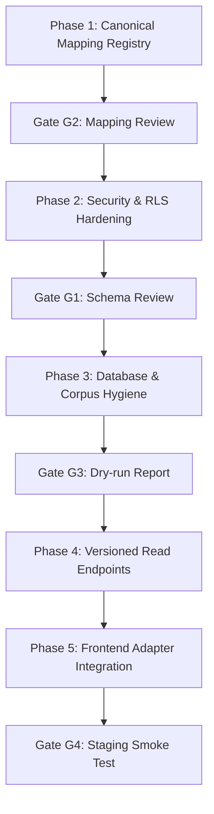

# Tark Study Library: Read Audit & Phased Implementation Plan

> **Deliverable**: Section 3 of `docs/handoffs/study-library-antigravity-contract.md`  
> **Status**: Ready for Human Review & Sign-Off (Human Gates G1 & G2)  
> **Author**: Antigravity Backend Agent  
> **Target System**: Tark 1.0 Study Library & Examiner's Psyche Analytics Engine  
> **Date**: 2026-10-21  

---

## 1. Executive Database & Corpus Audit

A live read-only audit was executed against the active Supabase PostgreSQL instance and local repository file corpora using `scripts/analytics/audit-study-library.ts` and `scripts/analytics/check-nodes.ts`.

### 1.1 Row Counts Across Core Tables

| Table / Corpus | Exact Count | Scope / Distribution Notes |
|---|---|---|
| `syllabus_nodes` (Database) | **137** | GS1: 28, GS2: 29, GS3: 47, GS4: 15, PRELIMS: 11, **CSAT: 4**, **ESSAY: 3** |
| `NODES` (`nodes.ts` TypeScript) | **130** | GS1: 28, GS2: 29, GS3: 47, GS4: 15, PRELIMS: 11 (**CSAT & ESSAY missing in TS file**) |
| `pyq_prelims` (Database) | **2,890** | 25 distinct exam years (2001–2025). 1,000/1,000 sampled clean. 0 dropped flags. |
| `pyq_mains` (Database) | **32** | 6 distinct exam years (2019–2024). Highly sparse coverage. |
| `pyq_node_analytics` (Database) | **137** | 137 nodes tracked. **105 nodes flagged as "drought"** (synthetic calculation). |
| `current_affairs` (Database) | **1,675** | Live news intelligence articles and distilled briefs. |
| `pib_digests` (Database) | **554** | Official Press Information Bureau daily digests. |
| `quiz_sessions` (Database) | **33** | Authenticated completed test attempts in production. |
| `training_sessions` (Database) | **0** (table absent) | Table does not exist in active schema; referenced only in legacy drafts. |
| `verified_pyqs_15yr.json` (Local) | **1,869** | Years 2000–2025. 2.3 MB. Currently prioritized first by `pyq_explorer.ts`. |
| `master_7841_pyqs.json` (Local) | **7,841** | Years 2000–2025. 5.4 MB. Comprehensive historical corpus. |

---

### 1.2 Root Cause Analysis: The `GS2.POL.CONSTITUTION` Pollution Defect

The audit revealed an extreme skew in `pyq_prelims`:
- **1,424 out of 2,890 questions (49.3%)** are tagged with node ID `GS2.POL.CONSTITUTION`.
- **62 out of 137 nodes (45.3%)** have exactly **0** prelims questions mapped to them.

**Investigation into Source Ingestion Scripts**:
In `scripts/ingest_25yr_pyq_vault.ts` (lines 141 & 163) and `scripts/ingest_massive_all_pyq_corpus.ts` (lines 98 & 130), the classification function was coded as:
```typescript
function mapCategoryToNode(category: string): string {
  return categoryMap[category] || "GS2.POL.CONSTITUTION"; // BLANKET FALLBACK
}
```
Any question from ancient history, geography, agricultural soils, money markets, or environment whose category string did not cleanly match the hardcoded map fell through into `GS2.POL.CONSTITUTION`.

**Compounding Query Defect**:
In `server-lib/analytics/routes.ts` (lines 147–175), when a node query returns fewer than 3 prelims, the handler performs an unbounded wildcard fallback:
```typescript
.ilike("stem", `%${terms[0]}%`)
```
This causes nodes like `GS1.GEO.MINERALS` to display irrelevant questions simply because the stem contains generic syllables.

---

## 2. Canonical Syllabus Node Mapping Dictionary

The 52 local editorial resources in `src/lib/study-library.ts` (created by Codex) use legacy tag identifiers. Below is the mapping dictionary reconciling every emitted tag to its canonical node ID in `syllabus_nodes`.

### 2.1 Notes Resources (15 Resources)

| Resource ID & Title | Emitted Legacy Tag | Canonical Node ID(s) | Relation | Mapping Basis & Resolution |
|---|---|---|---|---|
| `gs2-polity:note:GS2.POL.CONSTITUTION`<br>Basic structure & judicial review | `GS2.POL.CONSTITUTION` | `GS2.POL.CONSTITUTION` | 1:1 Direct | Canonical match: Preamble, Basic Structure Doctrine, Article 368. |
| `gs2-polity:note:GS2.POL.FEDERALISM`<br>Centre–state relations | `GS2.POL.FEDERALISM` | `GS2.POL.FEDERALISM` | 1:1 Direct | Canonical match: Seventh schedule, Article 356, GST Council. |
| `gs2-polity:note:GS2.POL.PARLIAMENT`<br>Parliamentary committees | `GS2.POL.PARLIAMENT` | `GS2.POL.PARLIAMENT` | 1:1 Direct | Canonical match: Lok Sabha, Rajya Sabha, PAC, privileges. |
| `gs2-polity:note:GS2.POL.INSTITUTIONS`<br>Constitutional & statutory bodies | `GS2.POL.INSTITUTIONS` *(Discrepancy)* | `GS2.POL.CONST_BODIES`<br>`GS2.POL.NON_CONST` | 1:N Junction | Note covers both constitutional (ECI, CAG, UPSC) and statutory/quasi-judicial bodies (NHRC, CVC, Lokpal, NGT). |
| `gs1-history-culture:note:GS1.CUL.ARCH`<br>Temple architecture | `GS1.CUL.ARCH` | `GS1.CUL.ARCH` | 1:1 Direct | Canonical match: Nagara, Dravida, Vesara temple architecture. |
| `gs1-history-culture:note:GS1.HIS.FREEDOM`<br>Gandhian movements | `GS1.HIS.FREEDOM` | `GS1.HIS.FREEDOM` | 1:1 Direct | Canonical match: Non-Cooperation, Civil Disobedience, Quit India. |
| `gs1-history-culture:note:GS1.CUL.PHILOSOPHY`<br>Buddhism & Jainism | `GS1.CUL.PHILOSOPHY` *(Discrepancy)* | `GS1.CUL.LIT_PHIL`<br>`GS4.ETH.THINKERS` | 1:N Cross-Paper | In canonical syllabus, philosophy spans GS1 Literature & Heritage and GS4 Moral Thinkers (Mahavira, Buddha). |
| `gs3-economy-infra:note:GS3.ECO.MONEY_BANK`<br>Monetary policy & liquidity | `GS3.ECO.MONEY_BANK` *(Discrepancy)* | `GS3.ECO.MONETARY`<br>`GS3.ECO.BANKING` | 1:N Junction | Resource spans RBI monetary policy tools (SDF, LAF) and banking insolvency/NPAs. |
| `gs3-economy-infra:note:GS3.SCI.NUCLEAR`<br>India’s nuclear power programme | `GS3.SCI.NUCLEAR` | `GS3.SCI.NUCLEAR` | 1:1 Direct | Canonical match: Nuclear energy and three-stage programme. |
| `gs3-economy-infra:note:GS3.ECO.EXTERNAL_SECTOR`<br>Balance of payments | `GS3.ECO.EXTERNAL_SECTOR` *(Discrepancy)* | `GS3.ECO.EXTERNAL` | 1:1 Alias | Canonical node in `nodes.ts` is `GS3.ECO.EXTERNAL` (External Sector & Foreign Investment). |
| `gs4-ethics-probity:note:GS4.ETH.DIMENSIONS`<br>Duty, consequences & public policy | `GS4.ETH.DIMENSIONS` *(Discrepancy)* | `GS4.ETH.INTERFACE` | 1:1 Alias | Canonical node in `nodes.ts` is `GS4.ETH.INTERFACE` (Ethics in Human Actions & Dimensions). |
| `gs4-ethics-probity:note:GS4.ETH.EI`<br>Emotional intelligence | `GS4.ETH.EI` | `GS4.ETH.EI` | 1:1 Direct | Canonical match: Emotional intelligence in governance. |
| `csat-analytical-core:note:CSAT.REASONING`<br>Assumptions & inferences | `CSAT.REASONING` *(Discrepancy)* | `CSAT.RC` | 1:1 Alias | Directly matches DB node `CSAT.RC` ("Reading comprehension passages, author's assumptions, critical inferences"). |
| `static-gk-vault:note:GS3.ENV.CONSERVATION`<br>Ramsar & the Montreux Record | `GS3.ENV.CONSERVATION` *(Discrepancy)* | `GS3.ENV.WETLANDS` | 1:1 Alias | Canonical node in `nodes.ts` is `GS3.ENV.WETLANDS` (Wetlands, Mangroves & Coastal Ecology). |
| `static-gk-vault:note:GS3.ENV.PROTECTED`<br>Protected areas | `GS3.ENV.PROTECTED` *(Discrepancy)* | `GS3.ENV.BIODIVERSITY` | 1:1 Alias | Canonical node in `nodes.ts` is `GS3.ENV.BIODIVERSITY` (Wildlife Conservation & Protected Areas). |

---

### 2.2 Storage & Query Architecture for Many-to-Many Mappings

To support 1:N and N:M relationships without altering stored resource identity:
1. **Database Schema (Additive)**:
   ```sql
   CREATE TABLE IF NOT EXISTS public.study_resource_node_mappings (
     id UUID PRIMARY KEY DEFAULT gen_random_uuid(),
     resource_id TEXT NOT NULL,                     -- e.g. 'gs2-polity:note:GS2.POL.INSTITUTIONS'
     node_id TEXT NOT NULL REFERENCES public.syllabus_nodes(id) ON DELETE CASCADE,
     relation_type TEXT NOT NULL CHECK (relation_type IN ('primary', 'secondary', 'cross_paper', 'prerequisite')),
     mapping_basis TEXT NOT NULL,                    -- Audited editorial rationale
     mapping_version TEXT NOT NULL DEFAULT 'v1.0',
     reviewer_status TEXT NOT NULL DEFAULT 'reviewed' CHECK (reviewer_status IN ('reviewed', 'provisional', 'deprecated')),
     created_at TIMESTAMPTZ NOT NULL DEFAULT timezone('utc', now()),
     UNIQUE(resource_id, node_id, mapping_version)
   );

   CREATE INDEX IF NOT EXISTS idx_srnm_node ON public.study_resource_node_mappings(node_id, mapping_version);
   CREATE INDEX IF NOT EXISTS idx_srnm_resource ON public.study_resource_node_mappings(resource_id);
   ```
2. **TypeScript Static Mirror (`src/lib/syllabus-mapping.ts`)**:
   A pure dictionary maps legacy IDs to canonical node sets. If the database is unreachable or offline, the frontend and API continue to resolve relations with zero degradation.

---

## 3. Security Audit & Remediation of `server-lib/analytics/routes.ts`

### 3.1 Parameter Acceptance Without Ownership Verification
- **Vulnerability**: `GET /examiner-psyche/user-autopsy/:userId` (lines 231–238).
  ```typescript
  analyticsRouter.get("/examiner-psyche/user-autopsy/:userId", async (req: Request, res: Response) => {
    const data = await getUserPsycheAutopsy(req.params.userId);
    res.json({ success: true, data });
  });
  ```
- **Severity**: **P0 High / Invariant Violation**.
- **Impact**: Any unauthenticated client can retrieve another user's cognitive vulnerability autopsy, 50:50 mistake ledger, and response times simply by supplying a target UUID.
- **Remediation**:
  Replace with authenticated route `GET /api/me/syllabus-progress` (or `GET /examiner-psyche/me/autopsy`).
  The user ID MUST be derived strictly from `supabase.auth.getUser(token)`:
  ```typescript
  const authHeader = req.headers["authorization"] || "";
  const token = authHeader.replace(/^Bearer\s+/i, "").trim();
  if (!token) return res.status(401).json({ error: "UNAUTHORIZED" });
  const { data: { user }, error } = await supabase.auth.getUser(token);
  if (error || !user) return res.status(401).json({ error: "UNAUTHORIZED" });
  const data = await getUserPsycheAutopsy(user.id);
  ```

---

### 3.2 Client-Supplied Correctness and Scoring Acceptance
- **Vulnerability**: `POST /examiner-psyche/telemetry` (lines 251–289).
  ```typescript
  analyticsRouter.post("/examiner-psyche/telemetry", async (req: Request, res: Response) => {
    const { userId, questionId, nodeId, isCorrect, marksDelta, ... } = req.body;
    await recordPsycheTelemetry({ userId, isCorrect: Boolean(isCorrect), marksDelta: Number(marksDelta), ... });
  });
  ```
- **Severity**: **P0 High / Invariant Violation**.
- **Impact**: A client can spoof exam scores, fake correct answers, manipulate accuracy percentages, and inject arbitrary user IDs without answering questions.
- **Remediation**:
  In accordance with Operational Invariant #2 ("Evaluation: Quiz scoring and answers are validated strictly server-side"):
  1. Telemetry records must originate from server-side evaluated sessions (`server-lib/submit-quiz.ts`).
  2. If an explicit telemetry call is made during practice, the server must look up the true `official_key` from `pyq_prelims` using `questionId`, evaluate `selectedOption === official_key`, calculate `marksDelta` (+2.0 or -0.66), and bind `user.id` from the bearer token.

---

### 3.3 Database Row Level Security (RLS) Policy Flaw
- **Location**: `supabase/migrations/20261015_examiner_psyche_engine.sql` (lines 71 & 80).
  ```sql
  CREATE POLICY "Users can insert their own psyche telemetry"
      ON public.user_psyche_telemetry
      FOR INSERT
      WITH CHECK (auth.uid() = user_id OR auth.uid() IS NULL); -- CRITICAL FLAW

  CREATE POLICY "Users can view their own psyche telemetry"
      ON public.user_psyche_telemetry
      FOR SELECT
      USING (auth.uid() = user_id OR auth.uid() IS NULL);      -- CRITICAL FLAW
  ```
- **Severity**: **P0 High**.
- **Impact**: `OR auth.uid() IS NULL` allows unauthenticated callers using the Supabase anonymous key to read and insert arbitrary records across all users.
- **Remediation Migration (`supabase/migrations/20261021_harden_psyche_rls.sql`)**:
  ```sql
  DROP POLICY IF EXISTS "Users can insert their own psyche telemetry" ON public.user_psyche_telemetry;
  DROP POLICY IF EXISTS "Users can view their own psyche telemetry" ON public.user_psyche_telemetry;

  CREATE POLICY "Users can insert their own psyche telemetry"
      ON public.user_psyche_telemetry
      FOR INSERT
      TO authenticated
      WITH CHECK (auth.uid() = user_id);

  CREATE POLICY "Users can view their own psyche telemetry"
      ON public.user_psyche_telemetry
      FOR SELECT
      TO authenticated
      USING (auth.uid() = user_id);
  ```

---

## 4. Specification of the 5 Versioned Read Endpoints

All endpoints follow RESTful conventions, reject malformed inputs, return standardized envelopes, and use appropriate HTTP caching headers.

```
Base URL: /api/syllabus
```

### 4.1 `GET /api/syllabus/catalog`
- **Purpose**: Public index of syllabus topics, paper hierarchies, resource summaries, and data version metadata.
- **Auth**: None (Public).
- **Cache-Control**: `public, max-age=3600, s-maxage=3600, stale-while-revalidate=86400`
- **Query Parameters**:
  - `paper?: string` (Optional filter: `GS1`, `GS2`, `GS3`, `GS4`, `PRELIMS`, `CSAT`, `ESSAY`).
- **Response Type**:
  ```typescript
  export interface SyllabusCatalogResponse {
    version: "2026.10";
    dataVersion: "pyq-25yr-v2";
    computedAt: string; // ISO 8601
    status: "available" | "partial";
    subjects: Array<{
      id: string; // e.g. "gs2-polity"
      title: string;
      badge?: string;
      canonicalPapers: string[];
      resourceCount: number;
      nodeCount: number;
    }>;
    nodes: Array<{
      id: string; // "GS2.POL.CONSTITUTION"
      paper: string;
      parent: string | null;
      path: string[];
      gloss: string;
      resourceCount: number;
      prelimsCount: number;
      mainsCount: number;
    }>;
    mappingVersion: "v1.0";
  }
  ```

---

### 4.2 `GET /api/syllabus/nodes/:nodeId`
- **Purpose**: Detailed syllabus topic profile, official syllabus reference, verified study resources, and evidence-backed metrics.
- **Auth**: None (Public).
- **Cache-Control**: `public, max-age=1800, s-maxage=1800, stale-while-revalidate=43200`
- **Path Parameters**:
  - `nodeId: string` (e.g. `GS2.POL.CONSTITUTION`).
- **Error Semantics**:
  - Unknown node: `404 Not Found` with `{ success: false, error: "UNKNOWN_NODE", message: "Node 'XYZ' is not recognized." }`.
- **Response Type**:
  ```typescript
  export interface SyllabusNodeDetailResponse {
    version: "2026.10";
    dataVersion: "pyq-25yr-v2";
    computedAt: string;
    status: "available" | "partial";
    node: {
      id: string;
      paper: string;
      parent: string | null;
      path: string[];
      gloss: string;
      entities: string[];
    };
    metrics: {
      prelimsTotal: {
        value: number;
        observedCorpusYears: { from: number; to: number };
        corpusName: "UPSC CSE Prelims 2001-2025 Master Corpus";
        isDirectNodeOnly: boolean;
      };
      mainsTotal: {
        value: number;
        observedYears: { from: number; to: number };
      };
      lastTestedYear: number | null;
      dominantOperator: string | null;
      isDroughtTopic: boolean;
      evidenceBasis: string; // e.g. "Calculated from 105 verified questions in active database"
    };
    resources: Array<{
      resourceId: string;
      subjectId: string;
      title: string;
      kind: "note" | "exam-note" | "map" | "reference" | "answer";
      relationType: "primary" | "secondary" | "cross_paper";
      sourceStatus: "editorial" | "reviewed_primary" | "provisional";
    }>;
    relationships: {
      parent: { id: string; title: string } | null;
      siblings: Array<{ id: string; gloss: string }>;
      crossCutting: Array<{ id: string; relation: string }>;
    };
  }
  ```

---

### 4.3 `GET /api/syllabus/nodes/:nodeId/questions`
- **Purpose**: Paginated eligible question references for a node.
- **Auth**: None (Public).
- **Cache-Control**: `public, max-age=3600, s-maxage=3600, stale-while-revalidate=86400`
- **Path Parameters**:
  - `nodeId: string`
- **Query Parameters**:
  - `stage?: "prelims" | "mains"` (default `"prelims"`)
  - `yearFrom?: number` (e.g. `2010`)
  - `yearTo?: number` (e.g. `2025`)
  - `page?: number` (default `1`)
  - `pageSize?: number` (default `20`, max `50`)
- **Behavior & Invariants**:
  - Unknown node returns `404 Not Found`.
  - Known node with 0 questions returns `200 OK` with `questions: []` and `totalItems: 0` (never substitutes unrelated questions).
  - Unanswered preview payloads **omit** `officialKey` and answer-revealing statements to preserve test integrity.
- **Response Type**:
  ```typescript
  export interface SyllabusNodeQuestionsResponse {
    version: "2026.10";
    dataVersion: "pyq-25yr-v2";
    computedAt: string;
    nodeId: string;
    stage: "prelims" | "mains";
    pagination: {
      page: number;
      pageSize: number;
      totalItems: number;
      totalPages: number;
    };
    eligibilityCriteria: {
      excludedDropped: true;
      excludedMalformed: true;
      isDirectNodeOnly: boolean;
    };
    questions: Array<{
      id: string;
      year: number;
      paper: string;
      questionNum: number | null;
      stem: string;
      options?: Array<{ id: string; text: string }>;
      directiveVerb?: string; // For Mains
      marks?: number;         // For Mains
      sourceCorpus: string;
    }>;
  }
  ```

---

### 4.4 `GET /api/syllabus/nodes/:nodeId/articles`
- **Purpose**: Real Intelligence and Current Affairs briefs linked to the syllabus topic.
- **Auth**: None (Public).
- **Cache-Control**: `public, max-age=300, s-maxage=300, stale-while-revalidate=1800`
- **Path Parameters**:
  - `nodeId: string`
- **Query Parameters**:
  - `page?: number` (default `1`)
  - `pageSize?: number` (default `10`, max `30`)
- **Behavior**:
  - Matches articles via validated syllabus tags or reviewed relationships.
  - Sorted by `published_at DESC` with stable tie-breaking on `id`.
  - Excludes full article markdown payloads to prevent high latency.
- **Response Type**:
  ```typescript
  export interface SyllabusNodeArticlesResponse {
    version: "2026.10";
    computedAt: string;
    nodeId: string;
    pagination: {
      page: number;
      pageSize: number;
      totalItems: number;
      totalPages: number;
    };
    articles: Array<{
      id: string;
      title: string;
      publishedAt: string;
      sourceName: string; // e.g. "PIB", "The Hindu"
      summary: string;
      route: string;      // e.g. "/intelligence/article-xyz"
      relationType: "direct_syllabus_tag" | "editorial_link";
      supportedReason?: string;
    }>;
  }
  ```

---

### 4.5 `GET /api/me/syllabus-progress`
- **Purpose**: Authenticated, ownership-scoped user practice history, accuracy by node, and cognitive bias metrics.
- **Auth**: **Mandatory Bearer Token** in `Authorization` header.
- **Cache-Control**: `private, no-cache, no-store, must-revalidate`
- **Error Semantics**:
  - Missing/Invalid Bearer token: `401 Unauthorized` with `{ error: "UNAUTHORIZED", message: "Valid session required." }`.
- **Response Type**:
  ```typescript
  export interface UserSyllabusProgressResponse {
    version: "2026.10";
    userId: string;
    computedAt: string;
    hasSufficientHistory: boolean;
    summary: {
      totalQuestionsAttempted: number;
      totalCorrect: number;
      accuracyPct: number;
      distinctNodesAttempted: number;
    };
    nodeProgress: Record<string, {
      attempts: number;
      correct: number;
      accuracyPct: number;
      lastAttemptedAt: string;
    }>;
    cognitiveBiases: Array<{
      operator: string;
      label: string;
      calls5050: number;
      accuracy5050Pct: number;
      bleedMarks: number;
    }>;
  }
  ```

---

## 5. Phased Implementation Roadmap & Verification Gates

Execution is segmented into strict, reversible phases governed by human verification gates.



### Phase 1: Pure Mapping Registry & Static Fallback Integrity
- **Scope**:
  - Create `src/lib/syllabus-mapping.ts` implementing the complete tag dictionary and many-to-many relationship registry.
  - Implement unit test suite verifying that all 52 `STUDY_RESOURCES` resolve to valid canonical nodes.
  - Enforce fallback behavior: if backend is unreachable, the UI functions seamlessly with honest editorial disclosure.
- **Verification**: `npm test` passes (all existing 156 tests + new mapping tests).
- **Rollback**: Delete `src/lib/syllabus-mapping.ts`; no database or server impact.

### Phase 2: Analytics Security & RLS Policy Hardening
- **Scope**:
  - Patch `server-lib/analytics/routes.ts`: remove unauthenticated `:userId` URL parameters; integrate Bearer token authentication via `supabase.auth.getUser(token)`.
  - Fix telemetry endpoint: enforce server-side scoring and official key validation.
  - Generate local additive migration `supabase/migrations/20261021_harden_psyche_rls.sql` to remove the `OR auth.uid() IS NULL` policy flaw.
- **Verification**:
  - Automated tests asserting HTTP 401 on unauthenticated access to `/api/me/syllabus-progress` and `/examiner-psyche/telemetry`.
  - Human review of migration SQL before database application.
- **Rollback**: Revert route edits; restore previous migration.

### Phase 3: Ingestion Logic Repair & Dry-Run Corpus Cleanup
- **Scope**:
  - Update `server-lib/cron/ingest/syllabus/nodes.ts` to include the 4 CSAT nodes (`CSAT.RC`, `CSAT.QUAN`, `CSAT.REAS`, `CSAT.DATA`) and 3 ESSAY nodes already present in the database.
  - Patch ingestion scripts `scripts/ingest_25yr_pyq_vault.ts` and `scripts/ingest_massive_all_pyq_corpus.ts` to remove the blanket `"GS2.POL.CONSTITUTION"` fallback.
  - Build dry-run categorization script `scripts/analytics/dryrun-pyq-recategorization.ts` to output proposed reassignment for the ~1,400 contaminated prelims rows without modifying production data.
- **Verification**: Gate G3 sign-off on the generated dry-run JSON report.
- **Rollback**: Script is strictly read-only / dry-run; no rollback needed.

### Phase 4: Implementation of 5 Read Endpoints
- **Scope**:
  - Implement `server-lib/syllabus/routes.ts` with the 5 versioned endpoints.
  - Mount `/api/syllabus` in `server.ts`.
  - Add integration tests verifying HTTP 200, 404, 401 error semantics, schema adherence, and caching headers.
- **Verification**: `npm run lint:api && npm test` passes.
- **Rollback**: Unmount router in `server.ts`.

### Phase 5: Frontend Adapter Integration
- **Scope**:
  - Update `src/lib/study-library.ts` to query the live catalog and question endpoints.
  - Maintain Codex's 6 collections, 5 kinds, view groups, and URL encoding (`/library?subject=...&view=...&item=...`).
  - Render honest empty and loading states when a topic has no tested questions.
- **Verification**:
  - Browser verification with Playwright.
  - Full lint and test suites: `npm run lint && npm test && npm run build`.

---

## 6. Verification and Human Gate Protocol

Before moving from Phase 1 to Phase 2/3:
1. **Gate G1 (Schema Review)**: Antigravity requests human review of `supabase/migrations/20261021_harden_psyche_rls.sql` before any migration command is run.
2. **Gate G2 (Mapping Review)**: Antigravity presents the 15-note mapping dictionary (Section 2) for human confirmation.
3. **Gate G3 (Dry-Run Corpus Audit)**: Antigravity delivers a JSON report of all re-categorized questions before updating `pyq_prelims`.
4. **Gate G4 (Staging Smoke Test)**: Complete verification in preview/staging environment before any deployment.
